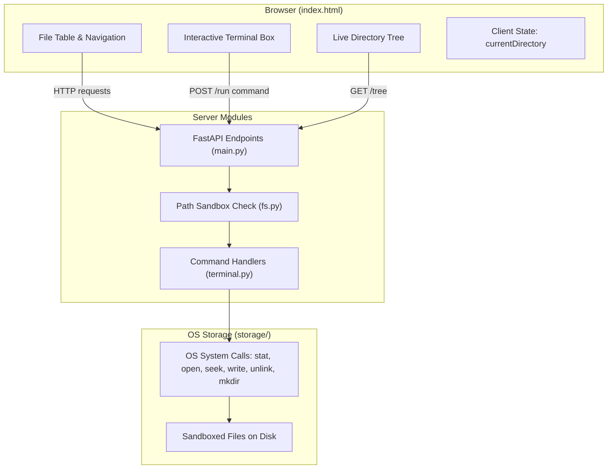
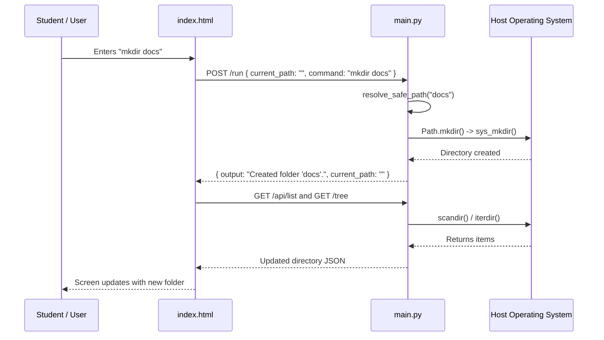
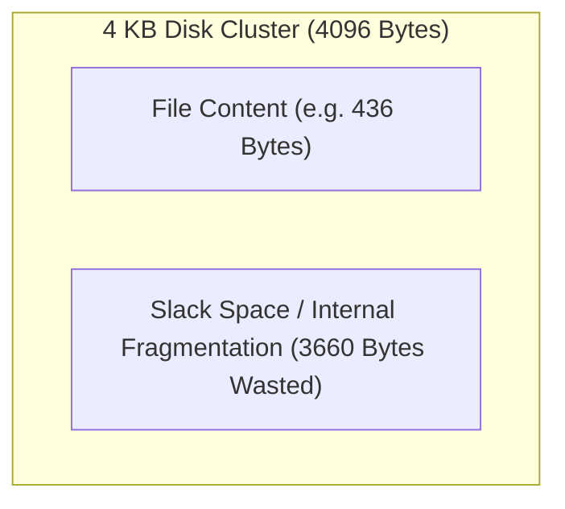

# Operating Systems Project Report: File System & File Management

**Course:** Operating Systems  
**Project:** File System & File Management  
**Environment:** Localhost (`127.0.0.1:8000`)  
**Stack:** Python (FastAPI, Uvicorn, Standard Library) + Vanilla HTML/CSS/JavaScript  

---

## 1. Project Overview

This project is a web-based file manager and terminal interface running on top of a sandboxed folder (`storage/`). It connects user-facing file management actions directly to the underlying operating system concepts: directory trees, file metadata, byte-level file repositioning, cluster block allocation, and access safety.

### What it does
- Provides folder navigation, file creation, file viewing, editing, renaming, and deletion.
- Supports low-level byte operations: moving the file offset pointer with `seek`, reading specific byte slices, and truncating files.
- Calculates physical disk block allocation using 4 KB cluster units and computes internal fragmentation (slack space).
- Enforces sandbox isolation so that file operations cannot reach outside the target directory.

---

## 2. Architecture and Data Flow

The project uses a modular client-server architecture. The server remains stateless: the browser keeps track of the current folder and sends it with each request.

- `main.py`: FastAPI routes, HTTP request validation, file upload/download endpoints, static assets serving.
- `fs.py`: Core filesystem operations, path sandbox check (`resolve_safe_path`), 4 KB block math, item metadata collection, and recursive directory tree builder.
- `terminal.py`: Command parser and dispatch table for terminal commands (`touch`, `mkdir`, `cd`, `write`, `read`, `seek`, `truncate`, `memmap`, `rm`).



### Request Lifecycle

When a command is executed in the terminal (for example, `mkdir docs`):



---

## 3. Core Operating System Concepts

### 3.1. Hierarchical Directory Structure
Operating systems represent persistent storage as an inverted tree starting from a root directory.

- **Recursive traversal (`build_tree`):** Iterates over folders and files using `Path.iterdir()`. Subfolders call `build_tree` recursively. This mirrors how Unix utilities use `opendir` and `readdir` to inspect directory entries.
- **Path navigation (`cd`):** Handles relative navigation (`cd docs`), parent navigation (`cd ..`), and root navigation (`cd /`). The client manages the current path string while the server resolves it against `storage/`.

---

### 3.2. File Descriptors and Byte-Level Repositioning (`seek`)
In operating systems, a file is treated as a linear sequence of bytes. A file descriptor tracks the current read/write offset.

- **Writing at an offset (`write <name> @<offset> <text>`):** Opens the file in `r+b` mode and calls `file.seek(offset)`. This directly triggers the `lseek` system call:
  - If the offset is inside the file, the bytes starting at that position are overwritten without changing earlier data.
  - If the offset is past the end of the file, the operating system extends the file and fills the intermediate space with zero bytes (`\x00`).
- **Reading ranges (`read <name> <start> <size>`):** Seeks to `start` and reads `size` bytes, showing how partial reads work.
- **Direct overwrite (`write <name> <text>`):** Replaces the whole file content.

---

### 3.3. Block Allocation and Internal Fragmentation

Operating systems do not allocate disk space byte by byte. Storage is allocated in fixed-size blocks (often called clusters), typically 4096 bytes (4 KB).



#### Block Allocation Formulas

Using `BLOCK_SIZE = 4096`:

```python
blocks = (size + BLOCK_SIZE - 1) // BLOCK_SIZE if size > 0 else 0
allocated_bytes = blocks * BLOCK_SIZE
slack_bytes = allocated_bytes - size if size > 0 else 0
```

- **Example 1:** A 436-byte file occupies 1 block (4096 bytes). Internal fragmentation is `4096 - 436 = 3660 bytes`.
- **Example 2:** A 5000-byte file requires 2 blocks (8192 bytes). Internal fragmentation is `8192 - 5000 = 3192 bytes`.
- **Example 3:** A 0-byte file uses 0 blocks and has 0 bytes slack.

The `memmap` command scans the whole sandbox and prints a table with file sizes, blocks used, and wasted slack bytes, summarizing total space consumption. The Properties modal shows this information for any selected file.

---

### 3.4. Metadata, Protection, and Permissions (`st_mode`)
Every file has metadata describing its type, timestamps, and permissions. In Unix, these live in inodes; in NTFS, they are stored in the Master File Table.

- **Metadata retrieval:** The backend calls `os.stat()`, which returns file size, creation timestamp (`st_ctime`), modification timestamp (`st_mtime`), and mode bits (`st_mode`).
- **Windows vs. Linux permissions:**
  - Linux stores read, write, and execute bits (`rwxrwxrwx`) for owner, group, and other in the inode.
  - Windows uses Access Control Lists (ACLs). When Python reads `st_mode` on Windows, it mostly reflects whether the file is marked read-only.
  - The Properties dialog displays this as `rw-rw-rw-` (or `r--r--r--`), includes the octal representation (`666` or `444`), and explains that Windows reflects the read-only flag while Linux holds full rwx bits.

---

### 3.5. Path Traversal Defense (`resolve_safe_path`)
Allowing user input to dictate filesystem paths can lead to path traversal attacks (e.g., inputting `../../` to access files outside the intended folder).

```python
def resolve_safe_path(user_path: str = "") -> Path:
    cleaned = user_path.strip().lstrip("/\\")
    resolved = (STORAGE_DIR / cleaned).resolve()
    storage_root = STORAGE_DIR.resolve()
    if resolved != storage_root and storage_root not in resolved.parents:
        raise HTTPException(status_code=400, detail="Access denied: Path is outside the sandbox.")
    return resolved
```

- Strips leading slashes so the input cannot override the base directory.
- Runs `Path.resolve()` to normalize `.` and `..` components and resolve any symlinks to their real target.
- Confirms that the target is inside `storage/`.
- Throws an HTTP 400 error immediately if someone tries to step outside.

---

## 4. System Call Mapping Table

| Project Feature | Code Implementation | POSIX System Call | Windows API Equivalent |
|---|---|---|---|
| Directory listing | `Path.iterdir()` / `os.scandir()` | `opendir`, `readdir` | `FindFirstFile`, `FindNextFile` |
| Make directory | `Path.mkdir()` | `mkdir` | `CreateDirectory` |
| Create file | `Path.touch()` / `open('wb')` | `open(O_CREAT)` | `CreateFile(CREATE_NEW)` |
| Delete file | `Path.unlink()` | `unlink` | `DeleteFile` |
| Delete directory | `shutil.rmtree()` | `rmdir` (recursive) | `RemoveDirectory` |
| Rename / move | `Path.rename()` | `rename` | `MoveFile` |
| Offset seek | `file.seek(offset)` | `lseek` | `SetFilePointerEx` |
| Truncate file | `file.truncate(size)` | `truncate`, `ftruncate` | `SetEndOfFile` |
| File attributes | `os.stat()` / `Path.stat()` | `stat`, `fstat` | `GetFileInformationByHandle` |

---

## 5. Terminal Commands Reference

| Command | Arguments | What it does |
|---|---|---|
| `mkdir` | `<name>` | Creates a new directory |
| `cd` | `<path>` | Changes current folder (`..` goes up, `/` goes to root) |
| `touch` / `create` | `<name>` | Creates a new empty file |
| `write` | `<name> <text>` | Overwrites file with text |
| `write` (offset) | `<name> @<offset> <text>` | Writes text starting at a specific byte offset |
| `cat` / `read` | `<name>` | Outputs the full file contents |
| `read` (slice) | `<name> <start> <size>` | Reads a specific byte slice from the file |
| `cp` / `copy` | `<src> <dst>` | Copies a file or folder |
| `mv` / `move` | `<src> <dst>` | Renames or moves a file or folder |
| `rm` / `delete` | `<name>` | Deletes a file or directory tree |
| `truncate` | `<name> <size>` | Sets file size to a specific byte length |
| `memmap` | *(none)* | Shows 4 KB block usage and slack space across all files |
| `reset` | *(none)* | Cleans up test files and resets storage to initial state |
| `clear` | *(none)* | Clears the terminal log window |

---

## 6. System Verification and Testing

To verify correctness against operating system concepts and error handling requirements, the following test scenarios were executed:

### 6.1. Path Traversal and Sandbox Confinement
- **Test case:** Attempt to escape `storage/` using relative traversal sequences (`cd ../..`, `read ../../main.py`, `write ../test.txt hello`).
- **Observed behavior:** `resolve_safe_path` strips leading slashes, resolves the normalized target path, and verifies that `storage/` is an ancestor of the resolved target. The server immediately aborts the operation with HTTP 400 (`Access denied: Path is outside the sandbox.`).
- **Test case:** Accessing valid subdirectories (`cd documents`, `read documents/project_notes.txt`).
- **Observed behavior:** Resolves safely inside the sandbox root and returns status 200 with the requested contents.

### 6.2. Byte Offset Writing and File Repositioning (`seek`)
- **Test case:** Overwriting a middle slice of a file using `write note.txt @5 insert`.
- **Observed behavior:** File is opened in binary read/write mode (`r+b`), `f.seek(5)` positions the pointer at byte index 5, and the payload is written. The first 5 bytes remain unchanged, and subsequent bytes are overwritten as expected.
- **Test case:** Writing beyond the current End of File (EOF) offset using `write note.txt @50 end`.
- **Observed behavior:** The operating system extends the file to 50 bytes by padding the unallocated gap with zero bytes (`\x00`), followed by the new payload, demonstrating sparse-style file extension.

### 6.3. Block Allocation and Internal Fragmentation Calculations
- **Test case:** File size = 0 bytes (`touch empty.txt`).
  - Expected: 0 blocks used, 0 bytes allocated, 0 bytes slack.
  - Calculated: `blocks = 0`, `allocated = 0`, `slack = 0`.
- **Test case:** File size = 174 bytes (`welcome.txt`).
  - Expected: 1 block (4096 bytes), slack = 4096 - 174 = 3922 bytes.
  - Calculated: `blocks = 1`, `allocated = 4096`, `slack = 3922`. Verified in `memmap` and file properties modal.
- **Test case:** File size = 5000 bytes.
  - Expected: 2 blocks (8192 bytes), slack = 8192 - 5000 = 3192 bytes.
  - Calculated: `blocks = 2`, `allocated = 8192`, `slack = 3192`.

### 6.4. File Truncation
- **Test case:** Reducing a 500-byte file down to 100 bytes via `truncate file.txt 100`.
  - **Observed behavior:** The OS updates the file size metadata to 100 bytes and drops the remaining bytes.
- **Test case:** Expanding a 100-byte file to 300 bytes via `truncate file.txt 300`.
  - **Observed behavior:** The OS extends the file length, and subsequent reads of the unwritten section return null bytes (`0x00`).

### 6.5. Platform-Specific Permissions (`st_mode`)
- On Windows development environments, `os.stat().st_mode` primarily reflects the read-only file attribute (`0o444` for read-only vs `0o666` for read-write). The UI and property inspector accurately flag this Windows-specific constraint while demonstrating the POSIX octal format and mode string mapping.
