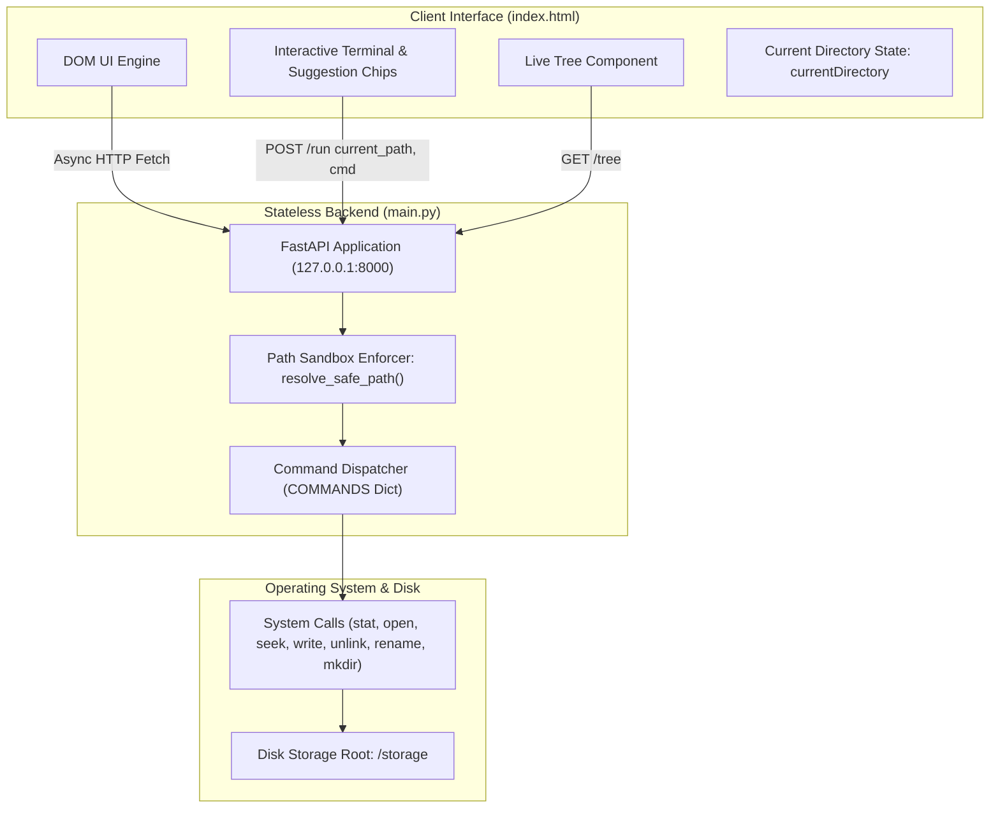
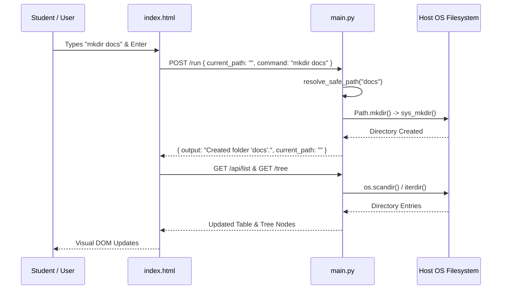
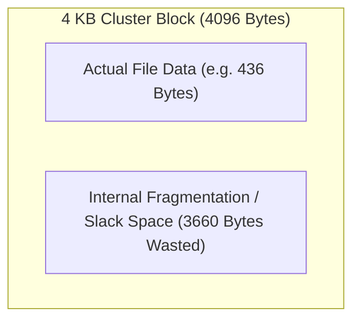

# Operating System Project Report: File System & File Management

**Course:** Operating Systems  
**Project Title:** File System & File Management  
**Environment:** Localhost (`127.0.0.1:8000`)  
**Stack:** Python (FastAPI, Uvicorn, Standard Library) + Vanilla HTML5/CSS/JavaScript  

---

## 1. Project Overview

This project implements a web-based file system and file manager operating over an isolated disk sandbox (`storage/`). It provides a visual graphical interface and an integrated interactive terminal line, mapping high-level user actions directly to low-level operating system concepts and system calls.

### Primary Objectives
1. Provide complete folder navigation and file CRUD operations without third-party frameworks or external libraries.
2. Demonstrate low-level file manipulations: byte-level repositioning (`lseek`), partial reads, offset writes, and direct truncation.
3. Model physical disk allocation in 4 KB cluster units and calculate internal fragmentation (slack space) across stored files.
4. Enforce strict sandbox isolation to prevent directory traversal attacks (`../`), absolute path escapes, and symbolic link dereferencing outside the root.

---

## 2. System Architecture

The project adheres to a clean two-tier client-server model. The backend remains stateless: the client tracks the active working directory and passes it as a parameter with each request.



### Component Breakdown

1. **Frontend (`index.html`):** Single-page application written in pure HTML5, CSS3, and ES6 JavaScript. Includes:
   - Live Directory Tree sidebar for full filesystem visibility.
   - Terminal input box with Tab autocompletion and one-click quick action buttons.
   - Dynamic file table with in-place text editor modal and detailed metadata inspection dialog.
2. **Backend (`main.py`):** Single Python file running an asynchronous ASGI server via Uvicorn. Exposes REST endpoints (`/api/*`, `/tree`, `/run`) using standard library utilities: `os`, `pathlib`, `shutil`, and `datetime`.
3. **Sandbox Directory (`storage/`):** The isolated filesystem root on the host machine. All paths outside this folder are inaccessible.

---

## 3. Operating System Concepts & Implementation

### 3.1. Hierarchical Directory Structure
Operating systems organize persistent storage into an inverted tree starting at a root directory.

- **Recursive Tree Traversal (`build_tree`):** Scans directories recursively using `Path.iterdir()`. Folders are evaluated first, followed by regular files. This mirrors how Unix `opendir()` and `readdir()` traverse directory inodes.
- **Directory Navigation (`cd`):** Supports relative navigation (`cd subfolder`), parent navigation (`cd ..`), and root reset (`cd /`). The client dynamically updates its breadcrumbs without requiring persistent server sessions.



---

### 3.2. File Descriptors & Byte-Level Repositioning (`seek`)
In operating systems, a file is an unformatted sequence of bytes. A file descriptor tracks the current file offset pointer.

- **Direct Content Replacement:** `write <name> <text>` truncates and overwrites file data using standard UTF-8 stream writes.
- **Offset Writing (`write <name> @<offset> <text>`):** Opens the target file in read-write binary mode (`r+b`) and calls `f.seek(offset)`. This directly models the `lseek` system call:
  - If the offset is within the file, it overwrites existing bytes starting at that position without altering preceding data.
  - If the offset is past the end of the file, the operating system expands the file, padding the intermediate gap with null bytes (`\x00`).
- **Partial Reading (`read <name> <start> <size>`):** Seeks to `start` and reads exactly `size` bytes.

---

### 3.3. Disk Block Allocation & Internal Fragmentation

Filesystems do not allocate storage byte-by-byte; they allocate in discrete disk blocks (clusters), commonly 4096 bytes (4 KB).



#### Calculations Used in the Project
Using the unified constant `BLOCK_SIZE = 4096`:
1. **Blocks Used:**
   $$\text{blocks} = \begin{cases} 0 & \text{if size} = 0 \\ \left\lfloor \frac{\text{size} + \text{BLOCK\_SIZE} - 1}{\text{BLOCK\_SIZE}} \right\rfloor & \text{if size} > 0 \end{cases}$$
2. **Physical Allocation:**
   $$\text{allocated\_bytes} = \text{blocks} \times 4096$$
3. **Internal Fragmentation (Slack Space):**
   $$\text{slack\_bytes} = \begin{cases} 0 & \text{if size} = 0 \\ \text{allocated\_bytes} - \text{size} & \text{if size} > 0 \end{cases}$$

- **`memmap` Command:** Outputs a complete usage table listing logical bytes, 4 KB block counts, and slack waste for every file in the sandbox, totaling space consumption across storage.
- **Properties Modal:** Displays both logical size and estimated physical cluster allocation with slack space for individual files.

---

### 3.4. Metadata, Protection & Permissions (`st_mode`)
Every file maintains attributes stored in metadata records (inodes in Unix, Master File Table records in NTFS).

- **System Call:** `os.stat()` extracts file size, creation timestamp (`st_ctime`), modification timestamp (`st_mtime`), and mode bits (`st_mode`).
- **Permissions Caveat (Windows vs. Linux):**
  - Linux stores granular owner/group/other read-write-execute bits in the inode.
  - Windows relies on Access Control Lists (ACLs). When Python reads `st_mode` on Windows, it maps file status primarily to the read-only flag.
  - The project shows the octal mode (e.g., `666` writable, `444` read-only) alongside a clear flag: `Read-only: Yes/No`, annotated with the architectural difference.

---

### 3.5. Sandbox Security: Preventing Path Traversal
Allowing arbitrary path input from a web interface introduces critical security risks, notably directory traversal (`../`) and unauthorized host modification.

`resolve_safe_path()` provides strict enforcement:
```python
def resolve_safe_path(user_path: str = "") -> Path:
    cleaned = user_path.strip().lstrip("/\\")
    resolved = (STORAGE_DIR / cleaned).resolve()
    storage_root = STORAGE_DIR.resolve()
    if resolved != storage_root and storage_root not in resolved.parents:
        raise HTTPException(status_code=400, detail="Access denied: Path is outside the sandbox.")
    return resolved
```
- **Leading Slash Removal:** Prevents `Path / "/etc"` from discarding the left-hand prefix and resolving to host root.
- **Canonicalization (`Path.resolve()`):** Resolves all relative dot-dot segments (`..`) and follows symbolic links to their physical targets on disk.
- **Ancestor Verification:** Ensures `storage/` is strictly in the path's parent hierarchy. Traversal attempts (such as `cd ../../` or `create ../../../hacked.txt`) immediately raise an HTTP 400 exception.

---

## 4. System Call Mapping Reference

| High-Level Action | Linux / POSIX Equivalent | Windows Win32 API | Project Implementation |
|---|---|---|---|
| Read directory | `opendir()`, `readdir()` | `FindFirstFile()`, `FindNextFile()` | `Path.iterdir()`, `os.walk()` |
| Create directory | `mkdir()` | `CreateDirectory()` | `Path.mkdir()` |
| Create file | `open(O_CREAT)` | `CreateFile(CREATE_NEW)` | `Path.touch()` |
| Remove file | `unlink()` | `DeleteFile()` | `Path.unlink()` |
| Remove directory | `rmdir()` | `RemoveDirectory()` | `shutil.rmtree()` |
| Move / Rename | `rename()` | `MoveFile()` | `Path.rename()` |
| Reposition offset | `lseek()` | `SetFilePointerEx()` | `file.seek(offset)` |
| Truncate file | `truncate()`, `ftruncate()` | `SetEndOfFile()` | `file.truncate(max_size)` |
| Read metadata | `stat()`, `lstat()` | `GetFileInformationByHandle()` | `Path.stat()`, `os.stat()` |

---

## 5. Command Reference

| Command | Syntax | Description |
|---|---|---|
| `mkdir` | `mkdir <name>` | Creates a new subfolder in the current directory. |
| `cd` | `cd <path>` | Changes working directory (`cd ..` moves up, `cd /` moves to root). |
| `touch` / `create` | `touch <name>` | Creates a new empty file. |
| `write` | `write <name> <text>` | Overwrites file with text. |
| `write` (offset) | `write <name> @<offset> <text>` | Writes bytes starting at an exact offset position. |
| `cat` / `read` | `cat <name>` | Displays the complete UTF-8 contents of a file. |
| `read` (range) | `read <name> <start> <size>` | Reads a specified byte slice from a file. |
| `cp` / `copy` | `cp <source> <target>` | Copies a file or folder within the sandbox. |
| `mv` / `move` | `mv <source> <target>` | Moves or renames an item. |
| `rm` / `delete` | `rm <name>` | Deletes a file or directory tree. |
| `truncate` | `truncate <name> <size>` | Shrinks or extends a file to an exact byte size. |
| `memmap` | `memmap` | Displays 4 KB cluster allocation and internal fragmentation. |
| `reset` | `reset` | Restores `storage/` to initial sample files. |
| `clear` | `clear` | Clears terminal log output. |

---

## 6. Viva Examination Questions & Answers

### Q1: How does your path traversal check prevent sandbox escape?
> "In `resolve_safe_path()`, we strip leading slashes so the input cannot override our directory prefix. We then call `Path.resolve()`, which resolves all relative dots (`..`) and follows any symlinks to their real target on the disk. Finally, we check if `storage/` is an ancestor of the resolved path. If someone sends `../../Windows`, it resolves outside the sandbox root, fails the ancestor check, and throws an HTTP 400 error."

### Q2: How does writing at an offset map to operating system primitives?
> "Opening the file in `r+b` mode and calling `f.seek(offset)` directly invokes the operating system's `lseek` system call. The OS repositions the file offset pointer in the kernel file descriptor table. The subsequent `write` modifies bytes starting at that pointer without rewriting previous data. If the offset is larger than the file, the OS zero-fills the gap."

### Q3: What is internal fragmentation in file systems, and how does your project calculate it?
> "Internal fragmentation occurs because filesystems allocate storage in fixed-size blocks (typically 4096 bytes) rather than individual bytes. If a file contains 500 bytes, the OS still allocates one full 4 KB block. The remaining 3596 bytes in that block cannot be used by other files and are wasted (slack space). In our code, slack is calculated as `(blocks * 4096) - size`."

### Q4: What does the `truncate` system call do to allocated disk blocks?
> "Calling `truncate(max_size)` modifies the file size in the inode/MFT metadata. If the new size is smaller than the current size, any disk blocks beyond that byte boundary are deallocated and returned to the filesystem's free list. If larger, the file size metadata expands, and read operations on the unwritten range return zero bytes."

### Q5: Why is your server stateless, and how is the current working directory tracked?
> "A stateless backend stores no per-client session or global directory state in server memory. Instead, the browser tracks `currentDirectory` and transmits it with every API request. This prevents state desynchronization between tabs, avoids memory leaks on the server, and allows straightforward restarts without losing user position."

### Q6: How does file deletion differ between regular files and directories?
> "Deleting a file uses the `unlink` system call, which removes the directory entry and decrements the inode's link count; when the link count reaches zero and no processes have it open, the data blocks are freed. Deleting a directory requires verifying it is empty using `rmdir`, or recursively traversing and unlinking all descendant entries, which our project handles via `shutil.rmtree`."

### Q7: Why do file permissions look different on Windows compared to Linux?
> "Linux implements POSIX permissions stored directly in the inode: 9 bits representing read, write, and execute for owner, group, and others (`rwxrwxrwx`). Windows uses NTFS Access Control Lists (ACLs) with security descriptors. When standard Python `os.stat` runs on Windows, it can only map whether the file has the read-only attribute set (`0o444` vs `0o666`), which our properties inspector notes explicitly."
